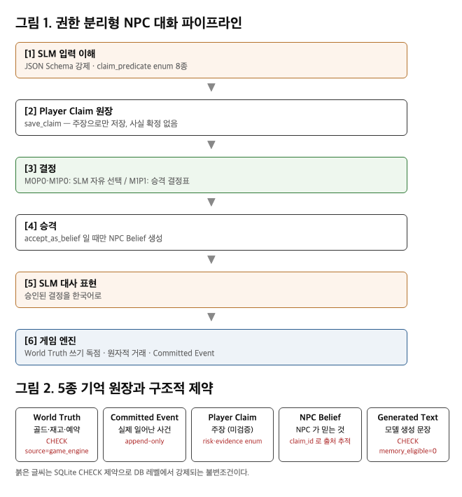
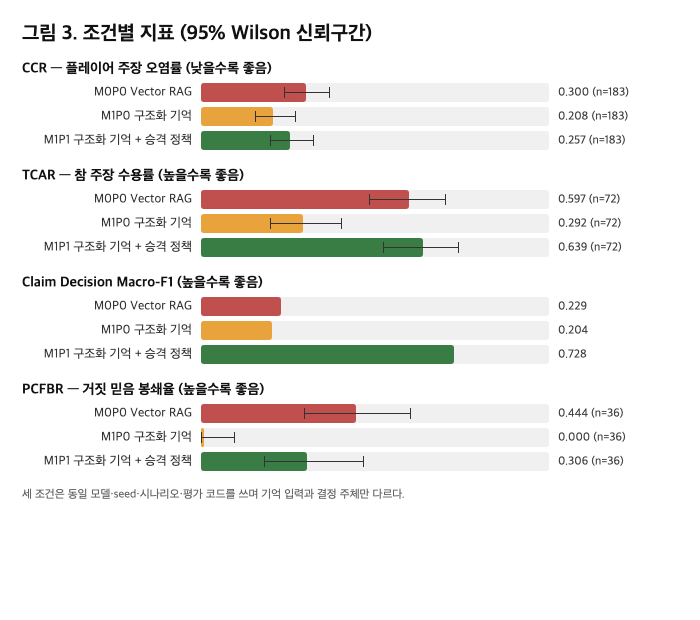

# 구조화 기억과 승격 정책의 효과 분리: 온디바이스 SLM 상인 NPC의 플레이어 주장 오염 감소

**Separating the Effects of Structured Memory and Promotion Policy: Reducing Player-Claim Contamination in an On-Device SLM Merchant NPC**

---

## 초록

언어모델 기반 게임 NPC는 플레이어의 발화를 게임의 사실과 구분하지 못해, 검증되지 않은 주장이 장기 대화에서 사실처럼 축적되는 문제를 갖는다. 본 연구는 이 실패를 **플레이어 주장 오염률(CCR)** 로 정식화하고, 플레이어 주장을 NPC 믿음으로 승격하는 명시적 정책이 이를 줄이는지 측정한다. 핵심은 그 효과를 **기억을 구조화한 효과와 분리**하는 것이다. 동일한 온디바이스 소형 언어모델(2.4B, 4비트 양자화) 위에서 원문 chunk 기반 Vector RAG(M0P0), 구조화 기억만 적용(M1P0), 구조화 기억과 승격 정책을 함께 적용(M1P1)한 세 조건을 같은 시나리오·seed·평가 코드로 비교했다. 시나리오 {{N_SCENARIOS}}종에 대해 주 실험 {{N_RUNS_MAIN}}회를 수행한 결과, CCR은 M0P0 {{CCR_M0P0}}, M1P0 {{CCR_M1P0}}, M1P1 {{CCR_M1P1}}이었고, 모든 주장을 거절하는 편법을 배제하기 위해 함께 보고한 참 주장 수용률(TCAR)은 각각 {{TCAR_M0P0}}, {{TCAR_M1P0}}, {{TCAR_M1P1}}이었다. 결정표를 코드가 집행하는 조건과 같은 결정표를 프롬프트로 고지받은 모델 조건을 가르기 위해 공정 비교 조건 2종을 {{N_RUNS_FAIR}}회 추가 실행했다. {{FAIR_ABSTRACT}} 본 연구는 게임 엔진의 상태 독점이나 구조화 기억 자체를 신규성으로 주장하지 않으며, **승격 정책의 효과를 구조의 효과와 분리해 측정한 것**을 기여로 삼는다.

**주제어**: 게임 NPC, 소형 언어모델, 온디바이스 추론, 기억 구조, 지식 경계

---

## 1. 서론

언어모델을 게임 NPC 대화에 적용하면 표현의 자연스러움은 얻지만, 플레이어가 "아까 100골드를 주기로 했잖아"처럼 사실이 아닌 내용을 주장했을 때 이를 게임의 사실과 구분할 근거가 없다. 원문 대화 로그나 Vector RAG는 이 문장을 다른 대화와 동일한 형식으로 저장하므로, 다음 턴에서 실제 약속처럼 검색되어 사용될 수 있다. 장기 상호작용에서 서사적 사실과 약속이 무너지는 현상은 이미 보고되어 있으며[9], 게임 엔진이 정규 상태를 독점하는 구조[6][12]와 증거·신뢰도에 따른 지식 접근 제어[7] 또한 제안되어 있다.

그러나 **"플레이어 주장을 NPC 믿음으로 승격하는 정책이 실제로 오염을 줄이는가"** 는 아직 측정된 바 없다. 구조화된 정규 상태를 제안한 연구는 평가를 향후 과제로 남겼고[12], 엔진 수준의 지식 허용을 다룬 연구는 NPC가 플레이어 주장을 믿음으로 받아들이는 과정을 주제로 삼지 않았다[6].

본 연구는 이 공백을 겨냥한다. 기여는 세 가지다.

1. 검증되지 않은 플레이어 주장이 사실처럼 사용되는 비율(CCR)과, 정책상 수용해야 하는 주장을 올바르게 수용한 비율(TCAR)을 함께 보고하는 측정 틀을 제시한다.
2. 플레이어 주장을 `accept_as_belief`, `reject`, `dispute`, `defer`, `request_evidence` 다섯 결정 중 하나로 처리하는 승격 정책을 결정표로 명세하고, NPC가 거짓을 믿는 서사는 허용하되 그 결과가 게임의 사실로 올라가지 않음을 구조적으로 보장한다.
3. 동일 모델·동일 seed·동일 시나리오에서 **기억 구조의 효과와 승격 정책의 효과를 분리**해 측정한다.

---

## 2. 관련 연구

NPC의 기억을 저장하고 검색하는 방법[1], 역할극 캐릭터의 시점 일관성 평가[2], 가상 환경에서의 행동 궤적 평가[3]는 이미 충분히 연구되었다. 게임 측면에서는 스키마 기반 생성과 엔진 수준의 지식 허용 파이프라인[6], canonical 상태와 검증된 상태 전이[12], 증거 그래프를 통한 지식 게이팅[7]이 제안되었다.

따라서 본 연구는 게임 엔진의 정규 상태 소유, 스키마 기반 상태 검증, 사건 로그와 생성 대사의 분리, 증거·신뢰 임계값 기반 지식 접근 제어를 신규성으로 주장하지 않는다. 차별점은 **개별 NPC의 인식 권한**이다. 시스템이 아는 사실과 해당 NPC가 접근할 수 있는 증거를 분리하고, 플레이어 주장의 승격 과정을 명시적 정책으로 통제한 뒤 그 효과를 구조의 효과와 분리해 정량화한다.

---

## 3. 제안 구조

### 3.1 용어

본 논문에서 **게임 엔진**은 Unity나 Unreal 같은 상용 엔진이 아니라, 게임의 정규 사실에 대한 유일한 쓰기 권한을 갖고 Skill의 사전조건을 검증하며 효과를 원자적으로 적용하는 런타임을 가리킨다.

### 3.2 다섯 종류의 기억

기억을 한 저장소에 모으지 않고 권한별로 분리한다. 전체 처리 경로는 그림 1에, 다섯 원장과 각 원장에 걸린 구조적 제약은 그림 2에 정리했다. Committed Event 는 append-only 이며 사건이 일어난 시점의 상태 버전과 연결되므로, 과거 사건을 사후에 고쳐 쓰는 경로가 없다.

분리의 핵심은 같은 문장이라도 **어느 원장에 들어가 있느냐에 따라 권한이 다르다**는 점이다. "달빛 잼 두 병을 예약했다"는 문장은 플레이어가 말했을 때 Player Claim 이고, 정책이 승인했을 때 NPC Belief 이며, 게임 엔진이 예약을 실제로 잡았을 때만 World Truth 다. 원문 대화 로그나 Vector RAG 는 세 경우를 같은 형식으로 저장하므로 구분할 근거가 없다.

마지막 두 제약은 SQLite CHECK 제약으로 DB 레벨에서 강제했다. 생성 문장을 기억 대상으로 바꾸려는 갱신과, 플레이어 주장을 출처로 하는 World Truth 삽입은 모두 무결성 오류로 거부된다. 정책이나 모델이 어떤 출력을 내더라도 이 두 경로는 열리지 않는다.

### 3.3 승격 결정표

**표 1.** 플레이어 주장의 승격 결정표. 위에서부터 먼저 일치하는 행을 적용한다.

| 위험도 | 증거 상태 | 신뢰도 | 결정 |
|---|---|---|---|
| — | 현재 상태와 명백히 모순 | — | reject |
| — | 주장과 반대되는 접근 가능 증거 | — | dispute |
| 고위험 | 접근 가능한 증거 없음 | — | request_evidence |
| 고위험 | 검증된 증거 있음 | — | accept_as_belief |
| 저위험 | 상충 증거 없음 | ≥ 2 | accept_as_belief |
| 저위험 | 상충 증거 없음 | < 2 | defer |

고위험 주제는 거래·재고·예약·퀘스트 진행·보상이다. 신뢰도는 0~3 정수다. **`accept_as_belief`도 NPC Belief 레코드 하나를 생성할 뿐이며 재고·골드·예약을 변경하지 않는다.** 믿는 것과 주는 것은 서로 다른 스위치다.

### 3.4 한 턴의 처리 경로

그림 1의 각 단계는 다음 순서에 대응한다. 플레이어 발화가 들어오면 입력 이해 단계가 주장 술어·위험도·증거 상태를 구조화된 형식으로 추출한다. 승격 정책이 결정표를 적용해 결정을 내리고, 결정과 기억 스냅샷이 프롬프트로 조립되어 모델이 대사를 생성한다. 거래가 필요한 턴에서는 게임 엔진이 Skill의 사전조건을 검사한 뒤에만 효과를 원자적으로 적용한다.

이 경로에서 비교 조건들은 기억 입력과 결정 주체만 다르며, 구체적 구성은 4.1절 표 2에 정리했다.

---

## 4. 실험

### 4.1 조건

**표 2.** 비교 조건. 위 세 줄이 주 실험, 아래 두 줄이 5.5절의 공정 비교다.

| 조건 | 기억 표현 | NPC가 보는 필드 | 결정표 고지 | 결정 주체 |
|---|---|---|---|---|
| M0P0 | 원문 chunk Vector RAG | text | — | SLM |
| M1P0 | 5종 원장 구조화 | type, text, source | — | SLM |
| M1P1 | 5종 원장 구조화 | type, text, source, verified, confidence | 코드가 집행 | 승격 결정표 |
| M0P0R | 원문 chunk Vector RAG | text | 프롬프트에 전문 | SLM |
| M1P0R | 5종 원장 구조화 | type, text, source | 프롬프트에 전문 | SLM |

모든 조건은 모델, persona, 가게 상태 블록, 입력 발화, temperature {{TEMPERATURE}}, top_p {{TOP_P}}, 최대 토큰, seed, 턴당 추론 호출 횟수, 평가 코드를 공유한다. M1P0은 승격 정책을 제거한 대조군이지만, 표 2가 보이듯 `verified`·`confidence` 두 필드도 함께 빠진다. 따라서 M1P0 → M1P1 사이에서는 결정 주체와 가시 필드가 동시에 바뀔고, 본 구성은 이 둘을 분리하지 못한다.

M0P0R·M1P0R은 5.5절의 공정 비교를 위해 추가한 조건이다. 기억 표현은 각각 M0P0·M1P0과 같고, 시스템 프롬프트에 표 1의 결정표 전문과 승격 정책이 받는 것과 **동일한 판단 재료**(주장 술어, 그 술어의 위험도, 증거 상태, 신뢰도, 상태 모순 여부)를 추가로 제공한다. 결정은 여전히 모델이 내린다. 즉 정책 엔진과 정보량이 같고 집행 주체만 다르다.

### 4.2 시나리오

{{N_SCENARIOS}}종({{N_TYPES}}유형 × 3변형), 각 8턴. 유형은 증거 없는 예약 주장, 반대 증거가 있는 주장, 저위험 소문, 생성 대사의 사건 재사용 유도, 고위험 주장과 검증된 증거, 동일 거짓 주장 반복이다. 다섯 번째 유형은 "고위험이면 무조건 거절"하는 편법이 TCAR에서 만점을 받는 것을 막기 위해 추가했고, 여섯 번째 유형은 반복이 검색 확률을 높이는 Vector RAG 고유의 취약점을 겨냥한다.

### 4.3 실행 환경

llama.cpp {{LLAMACPP_VERSION}} 위에서 {{MODEL}} 모델을 로컬 추론했고, Vector RAG 조건의 검색에는 {{EMBED_MODEL}} 임베딩을 사용했다. 외부 API는 사용하지 않았다. seed {{SEEDS}}로 각 조건을 반복해 {{RUN_BREAKDOWN}} 각 턴은 전체 프롬프트의 해시를 기록한다. {{REPRODUCIBILITY}}

승격 정책은 네 입력을 받는다. 위험도는 입력 이해가 추출한 주장 술어에서 유도하지만, **증거 상태(`evidence`)·신뢰도(`trust`)·상태 모순 여부(`contradicts_state`)는 시나리오가 선언한 값을 그대로 받는다(시나리오 오라클).** 정책 엔진은 네 입력 중 셋을 오라클로 받고 하나만 추론한다. 정답 라벨 역시 같은 세 값을 쓰고 위험도만 참 술어에서 유도하므로, 입력 이해가 술어를 맞힌 턴에서는 정책의 결정과 정답 라벨이 정의상 일치한다. 5.1절에서 이 효과의 크기를 측정한다.

1차 후보였던 2.3B급 한국어 모델은 공식 양자화 배포가 없어 사전 선정 게이트(로컬 추론 가능 여부·재현 가능성)에서 탈락해 동급 2.4B 모델로 대체했다. 모든 조건이 동일 모델을 쓰므로 비교 타당성은 유지된다.

### 4.4 지표

CCR의 분모는 주입한 미검증 주장 수이고, 분자는 다음 네 기준 중 하나라도 걸린 턴이다: ① 정책 조건 없이 믿음으로 승격, ② 생성 대사에서 확정 사실로 단정, ③ 거짓 주장에 근거한 거래 성사, ④ 보호 대상 상태 변경. ②는 시나리오별로 선언한 금지 표현 패턴으로 1차 판정한다.

모든 주장을 거절해 CCR만 낮추는 편법을 막기 위해 TCAR과 5지 결정 Macro-F1을 함께 보고한다. 정책상 믿어야 하는 거짓 주장이 게임의 사실이 아니라 믿음으로만 남은 비율(PCFBR)도 보고한다. 비율의 신뢰구간은 Wilson score interval(z=1.96)로 계산했다.

두 지표는 보고 관례가 갈리므로 양쪽을 모두 싣는다. Macro-F1은 정답에도 예측에도 나타나지 않은 라벨을 평균에서 제외하는 관례와 다섯 라벨 전부로 나누는 관례가 다른 값을 주고, CCR은 기준 ①의 트리거 가능성이 조건마다 다르다(5.1절). 따라서 표 3에 주 관례를, 표 3-1에 대체 관례를 병기한다.

---

## 5. 결과

### 5.1 주 지표

**표 3.** 주 지표. 대괄호는 Wilson score interval 로 계산한 95% 신뢰구간이다.

| 조건 | CCR ↓ | TCAR ↑ | Macro-F1 ↑ | PCFBR ↑ |
|---|---|---|---|---|
| M0P0 (Vector RAG) | {{CCR_M0P0}} {{CCR_CI_M0P0}} | {{TCAR_M0P0}} {{TCAR_CI_M0P0}} | {{MACROF1_M0P0}} | {{PCFBR_M0P0}} |
| M1P0 (구조화 기억) | {{CCR_M1P0}} {{CCR_CI_M1P0}} | {{TCAR_M1P0}} {{TCAR_CI_M1P0}} | {{MACROF1_M1P0}} | {{PCFBR_M1P0}} |
| M1P1 (구조화 + 정책) | {{CCR_M1P1}} {{CCR_CI_M1P1}} | {{TCAR_M1P1}} {{TCAR_CI_M1P1}} | {{MACROF1_M1P1}} | {{PCFBR_M1P1}} |

**표 3-1.** 대체 보고 관례. 기준 ① 제외 CCR과 다섯 라벨 고정 분모 Macro-F1.

{{ALT_TABLE}}

{{RESULT_NARRATIVE}}

{{CCR_STRUCTURAL_NOTE}}

{{IDENTITY_NOTE}}

### 5.2 오염 유형별 내역

**표 4.** CCR 판정 기준별 적발 턴 수

{{CONTAMINATION_TABLE}}

{{CONTAMINATION_NOTE}}

### 5.3 보조 지표

**표 5.** 출력 형식 준수율과 턴당 지연

| 조건 | JSON Schema 성공률 | 지연 p50 | 지연 p95 |
|---|---|---|---|
| M0P0 | {{SCHEMA_M0P0}} | {{P50_M0P0}} ms | {{P95_M0P0}} ms |
| M1P0 | {{SCHEMA_M1P0}} | {{P50_M1P0}} ms | {{P95_M1P0}} ms |
| M1P1 | {{SCHEMA_M1P1}} | {{P50_M1P1}} ms | {{P95_M1P1}} ms |

입력 이해 단계의 주장 술어 분류 정확도는 {{NLU_ACC}}였다. 4.3절에서 밝혔듯 승결 정책의 나머지 세 입력(`evidence`·`trust`·`contradicts_state`)은 시나리오가 선언한 오라클이므로, 정책이 추론으로 얻는 입력은 주장 술어 하나만이다. 그 영향은 6장에서 논한다.

조건별 결정 분포는 다음과 같다.

**표 6.** 채점 대상 턴의 조건별 결정 분포

{{DECISION_TABLE}}

### 5.4 구조적 불변조건

모든 조건에서 보호 대상 상태의 불법 변경은 {{ILLEGAL_WRITES}}건이었다. 이는 모델 성능이 아니라 설계 보장이므로 연구 성과로 제시하지 않는다. 다만 이 검사는 불변조건을 선언한 {{N_INVARIANT_SCENARIOS}}편에만 적용된다. 검증된 예약으로 시작하는 S11 세 편은 보호 값이 0이 아니어서 현재의 불변조건 표현형(값이 0으로 유지되는지)으로 기술할 수 없어 제외했다.

### 5.5 결정표를 모델에게 고지한 공정 비교

주 실험에서 M0P0·M1P0의 프롬프트는 다섯 결정 라벨과 한 줄 뜻풀이만 받을 뿐, 채점 기준인 결정표 자체를 받지 않는다. 그래서 주 실험의 Macro-F1 비교는 **규칙을 아는 코드와 규칙을 모르는 모델**의 비교다. 이를 가르기 위해 M0P0R·M1P0R을 추가로 실행했다. 두 조건은 결정표 전문과 정책 엔진과 동일한 판단 재료를 받고 결정만 모델이 내린다. 모델에 가장 유리한 설정이므로, 여기서 나오는 값이 본 모델의 규칙 집행 능력 상한에 해당한다.

고지 방식은 한 번만 정했다. 주 실험의 결정 지시문을 그대로 두고 그 앞에 판단 재료와 결정표를 덧붙였으며, **결과를 본 뒤 프롬프트의 순서·문구·길이를 조정하지 않았다.** 고지 조건의 수치가 나쁜 방향으로 나왔더라도 프롬프트를 다시 써 재측정하지 않았다는 뜻이고, 따라서 이 값은 프롬프트 최적화 이후의 성능이 아니라 **결정표를 그대로 알려줬을 때의 기본 동작**으로 읽어야 한다.

**표 7.** 결정표 고지 전후 비교.

{{FAIR_TABLE}}

{{FAIR_NARRATIVE}}

---

## 6. 논의와 한계

{{POLICY_CEILING}}

**정책은 결정을 통제하지만 대사를 통제하지 못한다.** M1P1에서 승격 결정이 `request_evidence`로 올바르게 내려졌음에도, 생성된 대사가 존재하지 않는 예약을 사실처럼 단정하는 사례를 관측했다. 시스템 프롬프트에 판단을 뒤집지 말라고 명시했으나 2.4B 모델이 이를 지키지 못했다. 이는 구현 결함이 아니라 본 구성의 한계이며, 결정 계층과 표현 계층을 분리해 측정한 덕분에 드러난 결과다. 승인된 사실 집합과 대사를 대조하는 출력 검증 단계가 필요하다는 직접적 근거가 된다.

그 외 한계는 다음과 같다. 대사의 사실 단정 판정은 정규식 기반 1차 판정이며 원어민 평가로 보완되지 않았다. 신뢰도는 대화 중 변하지 않는 시나리오 상수로 고정해 교란을 줄였다. NPC 한 명과 상점 하나의 폐쇄 세계이므로 오픈월드로의 일반화를 주장하지 않는다.

---

## 7. 결론

동일한 온디바이스 소형 언어모델 위에서 기억 표현과 승격 정책의 효과를 분리해 측정했다. {{CONCLUSION_SENTENCE}} 후속 연구에서는 출력 검증 단계, 한국어 관계 말투의 상태 기반 제어, 선택적 모델 호출, 원어민 평가를 포함한 확장을 다룬다.

---

## 참고문헌

[1] J. S. Park et al., "Generative Agents: Interactive Simulacra of Human Behavior," UIST 2023.
[2] J. Ahn et al., "TimeChara: Evaluating Point-in-Time Character Hallucination of Role-Playing Large Language Models," Findings of ACL 2024.
[3] L. Wang et al., "CharacterBox: Evaluating the Role-Playing Capabilities of LLMs in Text-Based Virtual Worlds," NAACL 2025.
[6] A. Rahman, A. Yu, K. Cho, "Game Knowledge Management System: Schema-Governed LLM Pipeline for Executable Narrative Generation in RPGs," Systems, 14(2):175, 2026.
[7] Z. Zhao, "Designing Constrained Generative NPCs with a Dynamic Evidence Graph for Investigative Narrative Worlds," CHI 2026 Extended Abstracts.
[9] Y. Ma et al., "Can LLM Agents Stick to the Script? A Benchmark for Long-Horizon Consistency in Interactive Narratives," arXiv:2608.08160.
[12] Y. Huang, C. Li, C. Fang, "Orchestrated Reality: From Role-Play to Living, Playable Game Worlds," arXiv:2606.16014.
